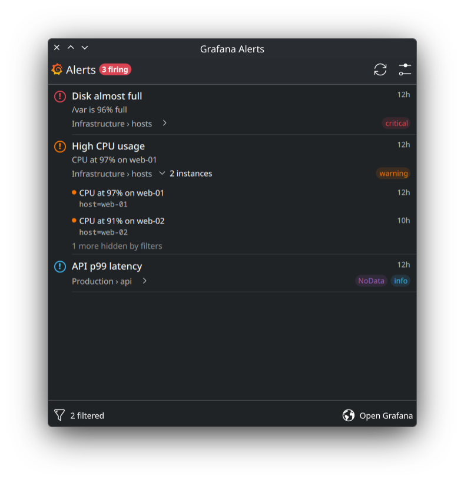

# Grafana Alerts for KDE Plasma 6

A Plasma 6 widget (plasmoid) port of the macOS app, in QML/Qt 6: the Grafana icon with a severity-colored firing count, a click-through list of rules and instances, silencing from the right-click menu, desktop notifications, and the same filters.

- **In a panel or the system tray**: the Grafana icon with a badge, a number, a dot, or nothing. Click for the list, middle-click to refresh. Right-click for Refresh Now, Open Firing Alerts in Browser and Open Silences in Browser.
- **In the list**: click a rule to open it in Grafana. Click the chevron to see its instances and the labels that set them apart. Right-click a rule or an instance to open its runbook or dashboard panel, silence it for 1 hour, 4 hours, 1 day or 1 week, hide it (the exact rule, its folder, or its group in that folder), or copy its name or labels.
- **On the desktop**: the list itself.



## Install

Requires Plasma 6 and `secret-tool` (in `libsecret`) for keyring storage.

```sh
make kde-install    # or: kpackagetool6 -t Plasma/Applet -i kde/package
```

Then right-click a panel or the desktop → **Add Widgets…** → **Grafana Alerts**. Settings are in the widget's **Configure…** dialog. **Account → Test Connection** checks your sign-in.

To remove it: `make kde-uninstall` (or `kpackagetool6 -t Plasma/Applet -r dev.grafanaalerts.plasmoid`).

After upgrading an installed copy, restart Plasma so it reloads the QML: `systemctl --user restart plasma-plasmashell`. To try it in a window without touching your panel: `plasmawindowed dev.grafanaalerts.plasmoid`.

## Signing in

Configure… → Account takes your Grafana URL (pasting any Grafana page URL works; the path is stripped) and one of:

| Mode | How it works |
| --- | --- |
| **Service account token** (default) | Administration → Users and access → Service accounts. **Viewer** is enough to read alerts, **Editor** also lets you silence them. The token goes in your keyring (KWallet or GNOME Keyring) through the Secret Service: Settings shows a `secret-tool store …` command to run in a terminal. It prompts for the token, so the token never appears in shell history or a process listing. |
| **Username & password** | Grafana basic auth, with the password in the keyring the same way. Doesn't work for SSO-only accounts. |
| **No auth** | For instances with anonymous access. |

With no URL set, the widget falls back to `GRAFANA_URL` and `GRAFANA_SERVICE_ACCOUNT_TOKEN` (or `GRAFANA_API_KEY`) in plasmashell's environment, the variables `mcp-grafana` uses. To use this, export them from a `.sh` file in `~/.config/plasma-workspace/env/`, which Plasma sources at login.

## How it differs from the macOS version

- **Secrets are stored with `secret-tool`** in a terminal, not typed into Settings: a widget can't hand a secret to a process without it showing up in a process listing. Settings tells you whether one is stored and can remove it. The widget keeps secrets in memory only.
- **Shell commands** (`secret-tool`, reading the environment) run through Plasma's executable data engine, since QML can't start processes on its own.
- **Desktop notifications** go through Plasma's notification system: critical alerts are sent as high urgency, and sounds follow System Settings → Notifications. Click one to open the rule.
- **Colors** come from your Plasma theme: critical uses its negative (red) color, warning its neutral (orange), pending its neutral, recovering its positive (green). Info is Breeze blue. Monochrome follows the panel's text color.
- **Filters page** shows one-click Hide buttons for the folders and labels on current alerts, and why rules are hidden, as of the last refresh.
- **Resume from suspend** is detected from a gap between clock ticks and triggers a refresh 5 seconds later. There's no network-change monitor, so after a network drop the widget recovers on the next poll.
- No launch-at-login setting (Plasma restores widgets itself) and no `--print` CLI.

## Files

| File | What's in it |
| --- | --- |
| `package/contents/code/grafana.js` | Parsing, states and severity, filters and label matchers, list building, banner diffing, links, errors, formatting. A port of `Models.swift`, `Filters.swift`, the parsing in `GrafanaAPI.swift`, URL handling in `Auth.swift`, and the list logic in `AlertStore.swift`. |
| `package/contents/ui/main.qml` | State, credentials, fetching, polling, desktop notifications, silencing |
| `package/contents/ui/Shell.qml` | Running `secret-tool` and reading the environment |
| `package/contents/ui/Logo.qml` | The Grafana icon drawn from its SVG path |
| `package/contents/ui/CompactRepresentation.qml` | Panel icon |
| `package/contents/ui/PopupView.qml`, `RuleRow.qml`, `StateIcon.qml`, `Pill.qml` | The list |
| `package/contents/ui/config*.qml`, `package/contents/config/main.xml` | Settings |

`make kde-test` runs the parser, filter, list and formatting tests under Node.
